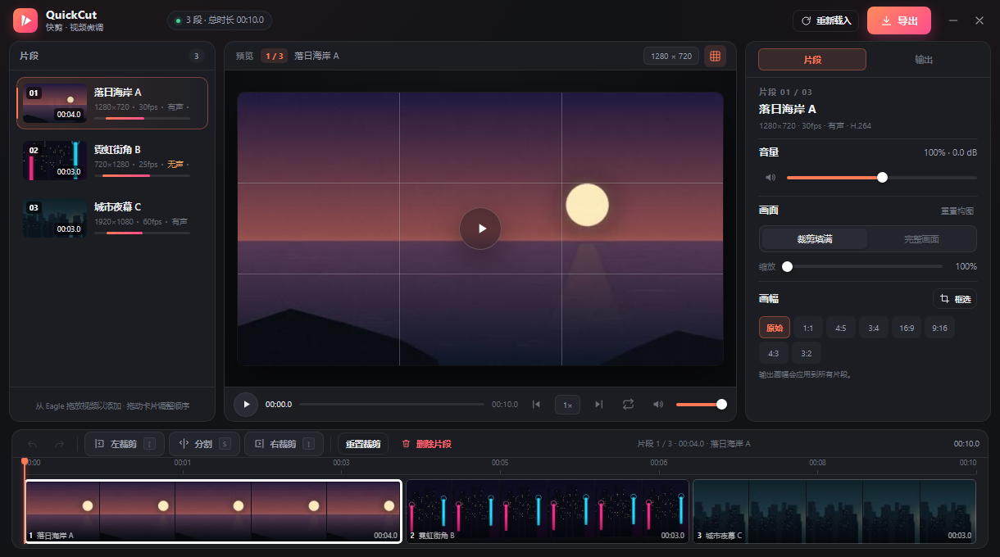
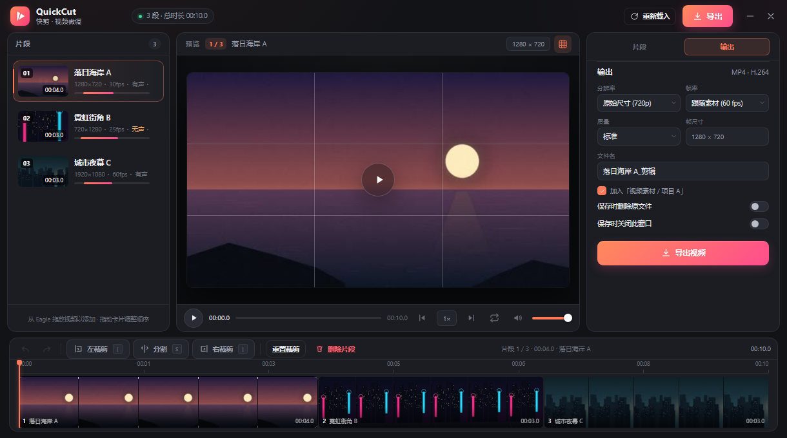

# QuickCut 快剪

在 Eagle 里快速完成视频裁剪、拼接、画幅调整、音量处理和导出。

QuickCut 是一个给 **Eagle 4** 用的轻量视频微调插件。素材已经收进 Eagle 时，不用再打开完整剪辑软件，把视频拖进来就能处理，导出后直接回到素材库。



## 功能

- 从 Eagle 拖放视频，或载入 Eagle 当前选中的视频
- 底部全宽时间轴：点击标尺跳转、拖动片段排序、左裁剪 / 分割 / 右裁剪
- 选中片段白框提示，时间轴缩略图按素材实际位置铺开
- 画幅：原始、1:1、4:5、3:4、16:9、9:16、4:3、3:2，以及手动框选
- 每段音量 0–200%，单独静音
- 慢放、逐帧、循环预览
- 撤销 / 重做
- 导出 MP4（H.264 + AAC），默认跟随源素材分辨率和帧率
- 导出完成自动加入 Eagle 当前文件夹
- 可设置「保存时删除原文件」和「保存时关闭窗口」



## 系统要求

- **Eagle 4.0.0+**
- **Windows 10 / 11**
- Eagle 的 FFmpeg 模块（首次处理视频时插件会提示）

> 目前只在 Windows 上完整测试。manifest 仍标记为 Windows；macOS 未验证。

## 安装

### 方式一：下载 Release

1. 打开 [Releases](../../releases/latest)，下载最新的 `quickcut-1.6.0.zip`。
2. 解压后会得到 `quickcut` 文件夹。
3. 把它放到：

   ```
   %APPDATA%\Eagle\Plugins\quickcut
   ```

   最终结构应为 `...\Plugins\quickcut\manifest.json`。

4. 完全退出 Eagle 后重新打开。

### 方式二：克隆源码

```powershell
git clone https://github.com/你的用户名/quickcut-eagle.git
cd quickcut-eagle
powershell -ExecutionPolicy Bypass -File .\install.ps1
```

`install.ps1` 会把插件复制到 Eagle 插件目录。安装前需要完全退出 Eagle。

## 使用

1. 在 Eagle 中选中视频，或直接打开 QuickCut 后从 Eagle 拖入视频。
2. 在底部时间轴点击片段选中；点时间标尺跳转。
3. 用「左裁剪 / 分割 / 右裁剪」或在右侧调整画面、画幅、音量。
4. 点右上角「导出」或按 `Ctrl+S` 导出。
5. 导出完成后视频会加入 Eagle 当前文件夹。

### 快捷键

| 按键 | 作用 |
| --- | --- |
| `Space` | 播放 / 暂停 |
| `[` / `]` | 左裁剪 / 右裁剪到播放位置 |
| `S` | 在播放位置分割 |
| `←` / `→` | 按素材帧率逐帧（`Shift` 为 1 秒） |
| `,` / `.` | 慢放 / 加快 |
| `C` | 手动框选画幅 |
| `Esc` | 取消框选；不在框选时关闭窗口 |
| `Delete` / `Backspace` | 删除当前片段 |
| `Ctrl/Cmd + Z` | 撤销 |
| `Ctrl/Cmd + Y` / `Ctrl/Cmd + Shift + Z` | 重做 |
| `Ctrl/Cmd + S` | 按当前设置导出 |
| `Ctrl/Cmd + Shift + ,` | 在 Eagle 中唤起插件（全局） |

## 输出说明

- 固定输出 **MP4 · H.264 + AAC**。
- 默认「跟随素材」：帧率取所有片段的最高帧率，分辨率按所有片段的最短边，画幅按首段素材。
- 可选分辨率：480p / 720p / 1080p / 1440p / 4K。
- 可选帧率：24 / 25 / 30 / 60fps。
- 导出过程中的临时文件位于系统临时目录，成功后会清理。

### 保存时删除原文件

默认关闭。开启时会弹出确认提示。开启后，只有在导出成功且视频已加入 Eagle 后，才会把来源素材移到 **Eagle 垃圾桶**，可以在 Eagle 垃圾桶恢复。删除后时间轴会清空。

### 保存时关闭窗口

默认关闭。开启后，导出成功会自动隐藏 QuickCut 窗口。

## 隐私

- 所有处理都在本机完成。
- 不上传素材、不连接外部服务、不需要登录。
- 只调用 Eagle 提供的 FFmpeg 模块和本机临时目录。
- 只有在用户主动开启「保存时删除原文件」时才会移动来源素材。

## 项目结构

```
.
├─ manifest.json
├─ index.html
├─ logo.png
├─ css/
│  └─ app.css
├─ js/
│  ├─ core.js       纯函数：画幅、裁剪、滤镜拼装
│  ├─ ffmpeg.js     ffprobe / ffmpeg 导出与缩略图
│  └─ app.js        界面与交互
├─ docs/
│  ├─ preview.png
│  └─ output-settings.png
├─ install.ps1
├─ CHANGELOG.md
└─ README.md
```

不需要构建步骤，也没有 npm 运行时依赖。Eagle 的 FFmpeg 模块由 Eagle 提供。

## 已知限制

- 只支持单轨剪辑，没有转场、字幕、关键帧动画。
- 导出会整体重新编码一次。
- 输出画幅是全局的，不同比例素材通过「裁剪填满 / 完整画面」适配。
- 分割出的后半段使用临时 ID，重新打开插件后不会保留「这段是分割出来的」状态。
- 目前只测试 Windows；macOS 未验证。

## 免责声明

QuickCut 是第三方插件，不属于 Eagle 官方，也不代表 Eagle 官方立场。Eagle 名称和商标归其所有者所有。

## 反馈

欢迎通过 GitHub Issues 反馈问题、提交建议或分享使用体验。

## 许可证

发布前请根据你的意愿添加 `LICENSE` 文件。若没有特别指定，默认保留所有权利。
